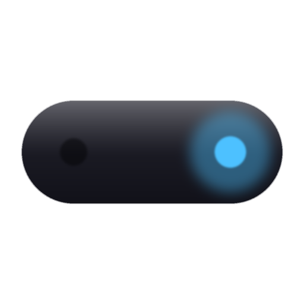
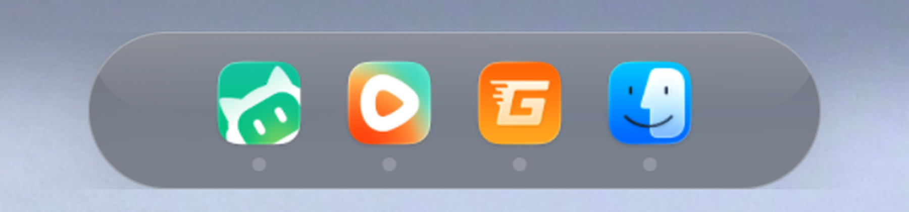
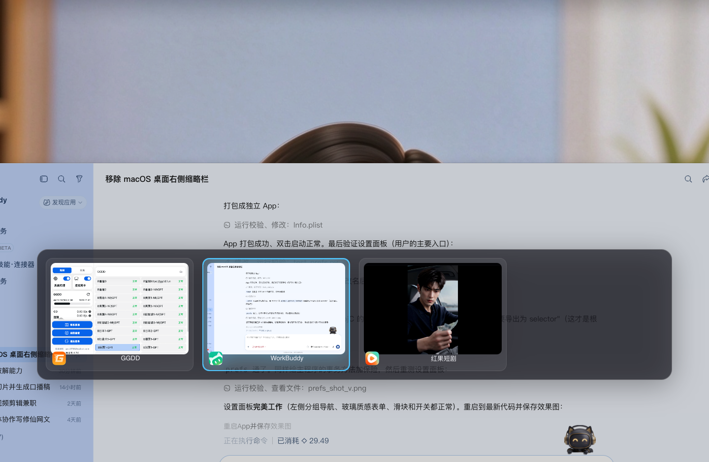

# 液态岛 · Liquid Island



把 **灵动岛** 和 **窗口切换器（AltTab 那种）** 合成一个 macOS 菜单栏应用。

- **灵动岛**：屏幕顶部（或侧边）一条玻璃胶囊，放着当前打开的应用。鼠标滑过去就展开，悬停某个图标能看到它的窗口实时缩略图，点一下直接切过去。
- **窗口切换器**：按住 `Option` 连按 `Tab` 循环选窗口，松开就切过去 —— 自带缩略图预览，告别盲切。

一个进程、一套配置，不用同时装两个工具。





---

## 安装

### 方式一：直接下载（推荐给朋友）

1. 从 Releases 下载 `液态岛-x.x.x.dmg`
2. 打开 dmg，把 **液态岛** 拖进 **Applications**
3. **第一次打开要右键 → 打开**（详见下方「为什么第一次要右键」）
4. 跟着引导页给两项权限，完事

### 方式二：从源码构建

```bash
git clone <你的仓库地址> liquid-island
cd liquid-island
./build.sh          # 自动建 venv、装依赖、打包、签名、出 dmg
```

产物在 `dist/`：`液态岛.app` 和 `液态岛-x.x.x.dmg`。

只想在本地跑源码（不打包）：

```bash
pip install -r requirements.txt
python main.py
```

---

## 第一次使用

启动后会弹出引导页，需要开两项系统权限：

| 权限 | 用途 | 不开会怎样 |
|---|---|---|
| **辅助功能** | 列出所有窗口、切换应用 | **切换器完全用不了**（窗口列表是空的） |
| **屏幕录制** | 抓窗口实时缩略图 | 能切换，但没有预览图 |

点「去授权」会直接跳到系统设置对应页面，勾上本应用即可。
授权后引导页的状态灯会自动变绿，不用重启（少数情况下系统会要求重启一次应用）。

> 如果当时点了「稍后再说」，也可以随时从菜单栏图标 → **权限与引导…** 再打开。

---

## 用法

| 操作 | 效果 |
|---|---|
| 鼠标滑到屏幕顶部中央（或侧边） | 唤出灵动岛 |
| 悬停某个应用图标 | 展开它的窗口卡片 / 缩略图 |
| 点图标 | 切到该应用 |
| 按住 `Option` + 连按 `Tab` | 打开窗口切换器并循环选择 |
| 松开 `Option` | 切到选中窗口 |
| `Esc` | 取消切换 |
| 菜单栏图标 | 设置 / 权限引导 / 诊断 / 关于 / 退出 |

快捷键、位置、主题、图标大小……都能在**设置面板**里改。

### 设置项速览

- **灵动岛**：位置（顶部居中 / 左 / 右 / 屏幕左缘 / 右缘）、显示在哪个屏（主屏 / 鼠标所在屏 / 所有屏）、收起时的样子（iOS 横杠 / 胶囊 / 圆点 / 完全隐形）、怎么展开（滑过 / 点击 / 快捷键）、主题（玻璃拟态 / 纯黑 / 浅色 / 跟随系统）、强调色、整体缩放
- **窗口卡片**：最多显示几张、是否显示缩略图、悬停多久才加载
- **切换器**：hold 键（Option / Command / Control）、循环键（Tab / 反引号 / 空格 / 方向键）、范围（全部 / 同应用 / 当前屏）、排序、列数、缩略图大小
- **通用**：开机自启、显示菜单栏图标、切换时收起灵动岛

---

## 常见问题

### 为什么第一次要「右键 → 打开」？

本应用没有做 Apple 开发者公证（公证需要付费的开发者账号），macOS 的 Gatekeeper
默认会拦下未公证的应用，报「已损坏，无法打开」或「来自身份不明的开发者」。

**这不是软件坏了。** 右键点击应用 → 选「打开」→ 确认一次，之后就能正常双击打开了。
（系统设置 → 隐私与安全性 里也会出现「仍要打开」按钮，效果一样。）

如果你有 Apple 开发者账号，可以自己做公证，就不用这一步了：

```bash
codesign --force --deep --sign "Developer ID Application: Your Name (TEAMID)" dist/液态岛.app
ditto -c -k --keepParent dist/液态岛.app 液态岛.zip
xcrun notarytool submit 液态岛.zip --apple-id you@example.com --team-id TEAMID --password <app专用密码> --wait
xcrun stapler staple dist/液态岛.app
```

### 装了但「什么都没发生」

十有八九是**辅助功能**没开。菜单栏找到胶囊图标 → **权限与引导…**，看状态灯；
或者直接跑 **诊断与自检…**，把结果复制出来——权限、屏幕、登录项、冲突软件都在里面。

### 和 AltTab 冲突吗？

冲突。两者默认都抢 `Option+Tab`。二选一：

- 用液态岛 → 关掉 AltTab 的开机自启（或卸载它）
- 两个都留 → 在设置里把液态岛的循环键改成 `` ` ``（反引号）之类的

诊断面板会自动检测正在运行的同类切换器并提示你。

### 多屏怎么办？

设置里「显示在哪个屏幕」：

- **只主屏** —— 岛固定在主屏
- **鼠标所在屏** —— 岛跟着你正在操作的那块屏走（多屏最舒服）
- **所有屏幕** —— 每块屏各放一个

插拔外接屏会自动识别，不用重启。

### 改了外观没生效？

涉及窗口/图层结构的改动需要重启：设置面板 → 关于 → **立即重启**，或菜单栏 → **重载配置（重启）**。

### 配置文件在哪？

`~/.config/liquid-island/config.json`，可以直接手改（改完重启）。
设置面板里有「恢复默认」。

---

## 项目结构

```
main.py        入口：组装各模块、菜单栏、主循环
island.py      灵动岛浮层（窗口、图层、悬停、窗口卡片）
switcher.py    窗口切换器浮层（AltTab 式交互）
core.py        公共能力：权限、窗口枚举、缩略图、图标
hotkey.py      全局热键（CGEventTap）
config.py      配置读写（JSON，缺键自动补默认）
prefs.py       +  prefs.html    设置面板（WKWebView + 玻璃拟态 CSS）
onboarding.py  首次运行授权引导
panels.py      「关于」与「诊断与自检」
version.py     版本号（改这里）
resources.py   资源定位（打包后 __file__ 会失效，靠它兜底）
tools/make_icon.py   图标生成脚本（改配色比例后重跑即可）
build.sh       一键打包
setup.py       py2app 配置
```

## 技术说明

- Python 3 + PyObjC（AppKit / Quartz / WebKit），无第三方 UI 框架
- 所有浮层都是自绘（CALayer），没有用 XIB/Storyboard
- 打包用 py2app，把 Python 运行时一起塞进 `.app`，对方机器上不需要装任何东西
- 事件循环只有一个（`AppHelper.runEventLoop`），两个浮层共用一个进程

## 许可

MIT，见 [LICENSE](LICENSE)。
